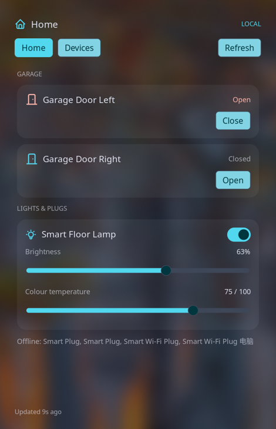

# Meross Deck for Noctalia

A native Noctalia 5 plugin for Meross garage doors, lights and plugs. It ports [Meross Deck](https://github.com/xiahongze/meross-deck) to Noctalia’s own panel, bar and desktop widgets. It connects to devices on your local network first and uses the Meross cloud when needed.



The screenshot uses test data; it does not show real door states.

## Features

- A bar widget and desktop tile open an attached control panel. The panel follows Noctalia’s palette.
- Garage doors show their reported state, obstruction warnings and timed movement. Open or close requires a second confirmation, which expires after six seconds. A confirmation waiting behind a slow request is discarded if it expires. The plugin never automatically retries an uncertain door command.
- Lights and plugs have on/off controls. Supported lights also expose brightness and colour temperature. Slider changes are batched.
- Offline devices remain visible but cannot be controlled. The Devices tab can hide or show individual devices.
- Local-first, local-only and cloud-only connection modes, with separate local and cloud refresh intervals. Cloud readings are cached to avoid unnecessary polling.
- Failed commands show an error, optimistic light changes are reverted, and the plugin refreshes after commands. Garage movement is an estimate based on the opener’s travel time; the device does not report a moving state.

## Requirements

- Noctalia 5 with plugin API 24 or newer; tested with Noctalia 5.4 and Niri. The old Quickshell-based Noctalia v4 has a different plugin API.
- Python 3.11 or newer. The helper uses only Python’s standard library.
- A Meross account with devices already set up in the Meross app.

## Install

Clone the repository and run:

```sh
./scripts/install.sh
```

Add **Meross Deck** to a bar in Noctalia settings, or add its desktop widget using the desktop widgets editor. Click the bar widget to open the panel. It can also be opened with:

```sh
noctalia msg panel-toggle xiahongze/meross-deck:panel
```

The installer registers the checkout as a local source, so keep the checkout in place. Alternatively, add the published repository as a git source:

```sh
noctalia msg plugins source add meross-deck git https://github.com/xiahongze/meross-deck-noctalia.git
noctalia msg plugins enable xiahongze/meross-deck
```

## Sign in and privacy

The plugin uses the same `~/.config/meross-deck/session.json` as the Plasma widget, respecting `XDG_CONFIG_HOME`. If that widget is already signed in, no credential copy or new sign-in is needed. The shared file contains the session token and account key and should have mode `0600`; the password itself is not stored.

If there is no session, use **Sign in…** in the panel. It opens a terminal for the email, password and any authenticator code. Click **Refresh** after the terminal finishes. To sign in manually from a checkout:

```sh
python3 meross-deck/bridge.py login
```

Signing in or signing out of the shared session affects both the Plasma and Noctalia widgets. The Noctalia panel does not sign out automatically.

Noctalia keeps a separate device cache and command log under `~/.cache/meross-deck-noctalia/meross-deck/`, respecting `XDG_CACHE_HOME`. On first use it seeds the cache from the Plasma widget when available. A separate MQTT client identity prevents it from disconnecting the Plasma widget. The cache directory is private to your user. Credentials are never placed in Noctalia settings, the repository, or command arguments.

## Settings

In Noctalia’s plugin settings you can change the title, connection mode and refresh intervals. The panel’s **Devices** tab controls visibility and persists that choice across restarts. A fresh command or manual refresh bypasses the cached cloud reading.

Meross uses signed JSON messages over LAN HTTP and cloud MQTT. [docs/API.md](docs/API.md) contains the protocol notes from the original project. The helper logs control commands and device replies in its separate `commands.log` for troubleshooting.

## Develop

```sh
make test       # original Python protocol tests plus Noctalia service and panel tests
make lint       # Python, Lua syntax and Noctalia plugin lint when available
make package    # dist/meross-deck-noctalia.tar.gz
```

The tests use redacted fixture data and mocked transports. They never send commands to real devices. The original helper and protocol tests are retained under MIT license from Meross Deck.

## Uninstall

```sh
noctalia msg plugins disable xiahongze/meross-deck
noctalia msg plugins source remove meross-deck-local
```

Use `meross-deck` as the source name if installed from git. The shared Meross session is left intact. Remove the separate Noctalia cache yourself if you no longer need it.

Not affiliated with Meross. Meross is a trademark of Chengdu Meross Technology Co., Ltd. MIT licensed.
